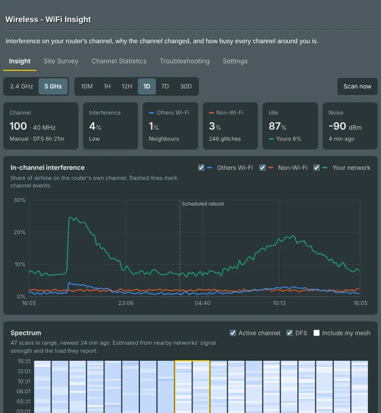
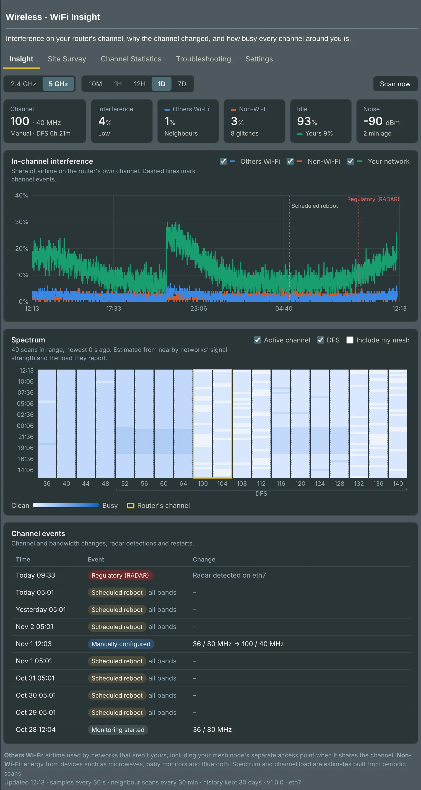
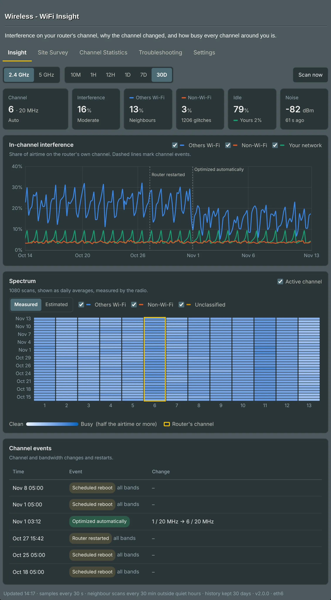
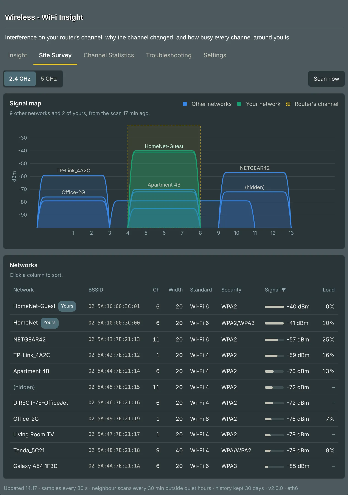
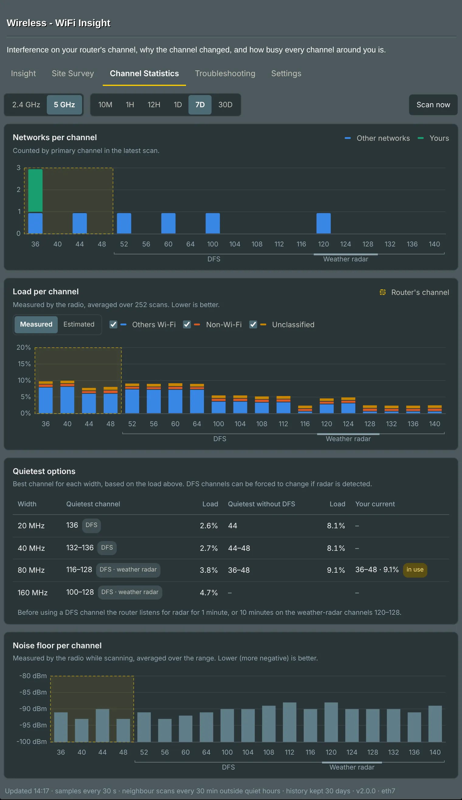
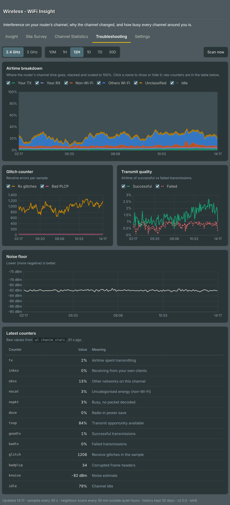
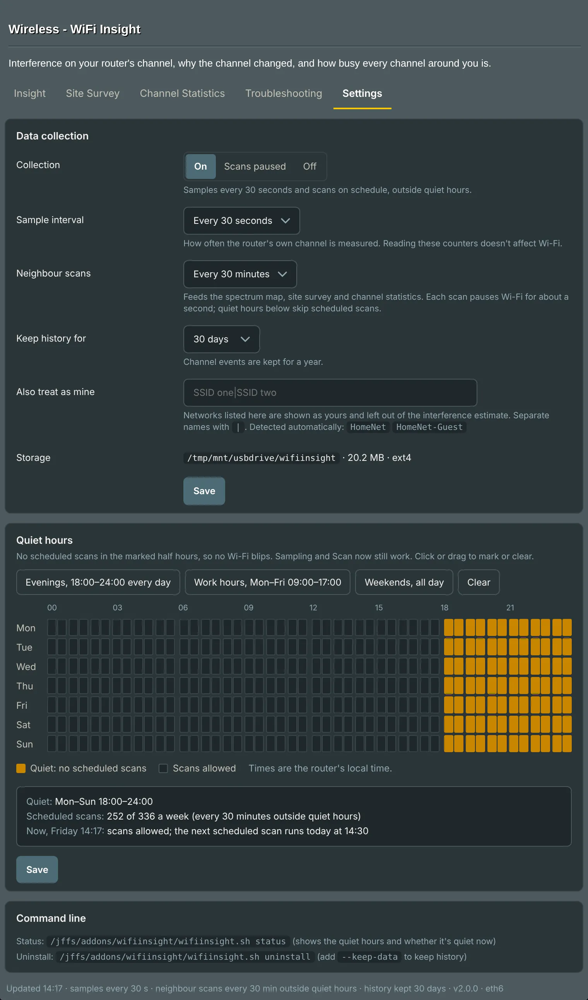

# WiFi Insight for Asuswrt-Merlin

A WiFi Insight-style dashboard for Broadcom-based Asuswrt-Merlin routers, with views like the old WiFi Radar's, rebuilt from scratch. It adds a **Wireless → WiFi Insight** tab that shows the interference on your router's channel, why the channel changed, and how busy every channel around you is.

> [!WARNING]
> **Use it at your own risk.** WiFi Insight was generated by Claude Opus 5.5 Extra, Anthropic's AI. I'm a Java Principal Developer in the gaming (sports betting) industry, not a router firmware or shell scripting specialist: I described what I wanted and tested it on my own RT-AX86U. It runs as root on your router and is provided as is, without warranty ([MIT licence](LICENSE)). Please read [What it changes on your router](#what-it-changes-on-your-router), or the script itself, before installing. Reviews from people who know Merlin well are very welcome.
>
> **About WiFi Radar:** RMerlin removed WiFi Radar from Merlin (3004.388.8) because Broadcom no longer maintained it and it had undocumented security issues, and he advises against adding it back. WiFi Insight doesn't reuse its code, but it does use Broadcom's driver tool (`wl`), so it can't be ruled out that some of those issues affect it.



| Page | What it shows |
|---|---|
| **Insight** | Live tiles, interference on your channel over time with event markers, a spectrum heatmap of every channel, and a log of channel changes, radar detections and reboots. |
| **Site Survey** | A signal map of the networks around you and a sortable list (BSSID, channel, width, Wi-Fi standard, security, signal, load). Your own networks and AiMesh nodes are marked. |
| **Channel Statistics** | Networks and load per channel, the noise floor per channel, and the quietest channel for each width (on 5 GHz with and without DFS, weather-radar channels marked). |
| **Troubleshooting** | Airtime breakdown, glitch counters, transmit success vs failure, noise floor and the raw `chanim_stats` counters. |
| **Settings** | Collection on, scans paused or off, sample and scan intervals, history length, extra SSIDs to treat as yours, and quiet hours with no scheduled scans. |

Ranges from 10 minutes to 30 days. Each radio has its own button: 2.4, 5 and 6 GHz, and 5 GHz-1/5 GHz-2 or 6 GHz-1/6 GHz-2 on routers with two radios on one band.

<details>
<summary>Screenshots</summary>

<table>
<tr>
<td width="50%"><a href="docs/insight.webp"></a><br><b>Insight</b>: interference on your channel and why it changed</td>
<td width="50%"><a href="docs/insight-30d.webp"></a><br><b>Insight, 30 days</b>: a month at a glance</td>
</tr>
<tr>
<td><a href="docs/survey.webp"></a><br><b>Site Survey</b>: who's around you, and on which channels</td>
<td><a href="docs/channels.webp"></a><br><b>Channel Statistics</b>: the quietest channel for each width</td>
</tr>
<tr>
<td><a href="docs/troubleshooting.webp"></a><br><b>Troubleshooting</b>: where the airtime goes</td>
<td><a href="docs/settings.webp"></a><br><b>Settings</b>: schedule, history and quiet hours</td>
</tr>
</table>

<sub>Screenshots use made-up sample data.</sub>
</details>

## Requirements

- Asuswrt-Merlin with **JFFS custom scripts and configs** enabled (the installer turns it on if needed).
- A Broadcom radio that answers `wl chanim_stats`. Every model current Merlin supports uses Broadcom Wi-Fi, and `check` confirms it.
- A **USB drive** for the history (about 21 MB for 30 days on two radios). It goes in a `wifiinsight` folder on the drive, `/tmp/mnt/<drive>/wifiinsight`, as Skynet keeps its data: with Entware, the drive Entware is on; with several drives and no Entware, the installer asks which. ext4 with a journal is safest; on a drive without one (FAT, exFAT, NTFS, ext2), a power cut while it's writing can damage the database, and the page says so.

**Entware and an extra sqlite3 aren't needed** on any Merlin from 386.1: WiFi Insight uses the firmware's own `sqlite3`. Entware's `sqlite3` is still used where the firmware has no suitable one (384.x), or if you point the config at it, so the option is kept just in case.

| Asuswrt-Merlin | Firmware's sqlite3 | Entware | Status |
|---|---|---|---|
| 3006.102.x | 3.42.0 | not needed | Works (user reports) |
| 3004.388.6 and later | 3.42.0 | not needed | Tested on 3004.388.13_0 |
| 386.1 – 3004.388.5 | 3.25.3 | not needed | Should work: the tests run with this sqlite3 too |
| 384.15 – 384.19 | too old | needed (`opkg install sqlite3-cli`) | Untried |

## Supported routers

| Router | Radios | Status |
|---|---|---|
| RT-AX86U | 2.4 + 5 GHz | Tested, including the measured spectrum |
| RT-AX86U Pro | 2.4 + 5 GHz | Works (user reports) |
| RT-AX88U, GT-AX6000 | 2.4 + 5 GHz | Works (user reports); on a DFS channel the driver refuses full 5 GHz scans (see below) |
| RT-BE88U | 2.4 + 5 GHz | Works (user reports); some refuse full 5 GHz scans on a DFS channel |
| RT-BE96U | 2.4 + 5 + 6 GHz | Works, including 6 GHz (user report) |
| RT-AX58U (V1), RT-AX68U, RT-AX88U Pro, RT-BE86U, RT-BE58 Go | 2.4 + 5 GHz | Should work |
| GT-AXE11000, RT-BE92U, GT-BE19000AI | 2.4 + 5 + 6 GHz | Should work |
| GT-AX11000, GT-AX11000 Pro, ZenWiFi Pro XT12 | 2.4 + 5 + 5 GHz | Should work since 2.0.0: 5 GHz-1 and 5 GHz-2 kept apart |
| GT-AXE16000 | 2.4 + 5 + 5 + 6 GHz | Should work since 2.0.0 |
| GT-BE98 Pro | 2.4 + 5 + 6 + 6 GHz | Should work since 2.0.0: 6 GHz-1 and 6 GHz-2 kept apart |

*Should work*: meets the requirements and its radio layout comes from the Merlin source, but nobody has reported running it yet. Models on a sibling's firmware (RT-AX3000 V1, RT-AX86S, RT-BE7200) should match it; older models and Gnuton's firmware are untried. `check` tells you before anything is installed, and a [router report](https://github.com/IfSugar/wifiinsight/issues/new/choose) helps add your model.

**Scans refused on DFS channels.** Some drivers refuse full 5 GHz scans while the router is on a DFS channel (52–144). WiFi Insight then scans one channel at a time, spread out over the scan interval, and the page says so. For full scans, use a channel outside 52–144: in Wireless → General, un-tick "Enable 160 MHz" and "Auto select channel including DFS channels". That costs 160 MHz in most regions, and the other channels may be busier.

## Install

Over SSH on the router:

```sh
curl -fsL --retry 3 "https://github.com/IfSugar/wifiinsight/releases/latest/download/wifiinsight.sh" -o /tmp/wifiinsight.sh && sh /tmp/wifiinsight.sh install
```

<details>
<summary>Without internet access on the router</summary>

Copy `wifiinsight.sh` and `wifiinsight.asp` from this repo to the router, then run the installer:

```sh
scp -O wifiinsight.sh wifiinsight.asp admin@192.168.50.1:/tmp/
ssh admin@192.168.50.1 'sh /tmp/wifiinsight.sh install'
```

The page then loads Chart.js from the jsDelivr CDN.
</details>

The installer checks the requirements first and stops without changing anything if one fails. Then it copies the addon to `/jffs/addons/wifiinsight/`, creates the history folder on the drive, downloads Chart.js (checked against its SHA-256), hooks into `services-start` and `service-event`, mounts the page and takes a first sample and scan.

Open **Wireless → WiFi Insight**. If the tab doesn't show, reload with **Ctrl+F5** (Windows) or **Cmd+Shift+R** (Mac); the installer also prints a direct link.

**Updating:** `/jffs/addons/wifiinsight/wifiinsight.sh update` installs the latest release, keeping settings, history and the page slot. An install from before 2.0.0 moves its history from `/opt/var/lib/wifiinsight` to `wifiinsight/` on the same drive: a rename, nothing is copied, and a link is left at the old path. `update dev` installs the newest unreleased code on `main` (or `update dev <branch>`), for testing a fix.

**Menu and amtm:** run the script with no arguments for a menu. It supports amtm's script updates; see [amtm](#amtm).

## How it works

- **Your channel:** every 30 s the driver's airtime counters (`wl chanim_stats`) are read: other networks (`obss`), non-Wi-Fi energy (`nocat`) and your own traffic (`tx`, `inbss`). Reading them doesn't disturb Wi-Fi.
- **Every other channel:** a neighbour scan (`wl scan`) every 30 minutes by default, outside quiet hours. Each scan takes the radio off-channel for about a second. Where the driver reports it (the RT-AX86U on 3004.388, the GT-AX6000 on 3006.102), the page shows the airtime the radio **measured** on each channel while scanning; otherwise an **estimate** from the networks heard there, by overlap, signal and advertised load. Your own networks, AiMesh nodes included, are kept out unless you tick *Include my mesh*.
- **Refused scans:** a full scan is always tried first. If the driver refuses it, the band is scanned one channel at a time at once, then spread over about a third of the scan interval at later scans (a short trip off-channel each, at most 3 a minute, never in quiet hours). A full scan is retried every 6 hours. *Scan now* always scans the whole band.
- **Channel events:** a changed setting is *Manually configured*, a radar line in the syslog is *Regulatory (RADAR)*, a new width on the same channel is *Adaptive bandwidth*, and acsd's choice is *Optimized automatically*. Reboots are spotted from the uptime, and matched to your reboot schedule.

**Quiet hours:** mark the half hours of the week when a scan's hiccup would get in the way (gaming, calls), on the Settings grid or from a preset. Sampling carries on and *Scan now* still works. **Collection** switches everything: *On*, *Scans paused* (sampling only), or *Off* (nothing runs, nothing is lost).

## Commands

```sh
/jffs/addons/wifiinsight/wifiinsight.sh             # the menu
/jffs/addons/wifiinsight/wifiinsight.sh check       # can this router run it? (changes nothing)
/jffs/addons/wifiinsight/wifiinsight.sh status      # what's running, storage, sqlite3, quiet hours, recent events
/jffs/addons/wifiinsight/wifiinsight.sh scan        # scan now and print each radio's result
/jffs/addons/wifiinsight/wifiinsight.sh collection paused   # on, paused or off
/jffs/addons/wifiinsight/wifiinsight.sh debug       # details for an issue (no network names or addresses)
/jffs/addons/wifiinsight/wifiinsight.sh repair      # rebuild a damaged database; keeps the damaged copy as .bad
/jffs/addons/wifiinsight/wifiinsight.sh migrate     # move history from /opt/var/lib/wifiinsight (update does this)
/jffs/addons/wifiinsight/wifiinsight.sh update      # install the latest release (update dev: unreleased code)
/jffs/addons/wifiinsight/wifiinsight.sh uninstall   # remove everything (--keep-data keeps the history)
```

<details>
<summary>Files, cron jobs and config</summary>

| Path | Contents |
|---|---|
| `/jffs/addons/wifiinsight/` | script, page, config, local Chart.js |
| `/tmp/mnt/<drive>/wifiinsight/` | the history database (`wifiinsight.db`), and small state files |
| `/opt/var/lib/wifiinsight` | only on installs from before 2.0.0: a link to the folder above |
| `/tmp/var/wwwext/wifiinsight/` | the JSON files the page reads, rebuilt from the database |

Cron jobs: `wifiinsight_collect` (every minute), `wifiinsight_scan` (the scan interval), `wifiinsight_trickle` (every minute; does nothing unless full scans are refused) and `wifiinsight_prune` (04:23 daily).

The config, `/jffs/addons/wifiinsight/config`, is written by the Settings page; after editing it by hand, run `wifiinsight.sh startup`.

```sh
SAMPLE_INTERVAL=30         # 30 or 60 seconds
SCAN_INTERVAL=30           # minutes, 0 = off
RETAIN_DAYS=30             # samples and scans; events are kept for a year
EXTRA_OWN_SSIDS=""         # extra SSIDs to treat as yours, separated by |
COLLECTION=on              # on, paused or off
QUIET=""                   # quiet hours: 84 hex digits, one bit per half hour from Monday 00:00; empty = none
AMTM_UPDATE=on             # on: amtm may update WiFi Insight
DATA_DIR="/tmp/mnt/<drive>/wifiinsight"   # set at install
SQLITE="/usr/sbin/sqlite3"                # the firmware's, or Entware's /opt/bin/sqlite3
```
</details>

## amtm

With no arguments in a terminal the script shows its menu. `wifiinsight.sh amtmupdate check` exits 0 when amtm may update it (1 when turned off in the menu), and `wifiinsight.sh amtmupdate` installs the latest release and prints two lines. Until WiFi Insight is in amtm's list, add `/jffs/addons/wifiinsight/wifiinsight.sh` there as a personal script.

<details>
<summary>For amtm's maintainer</summary>

| | |
|---|---|
| Script | `/jffs/addons/wifiinsight/wifiinsight.sh` |
| Version line | `^VERSION=` |
| Remote script | `https://github.com/IfSugar/wifiinsight/releases/latest/download/wifiinsight.sh` |
| Check string | `IfSugar/wifiinsight` |
| Install | download the remote script to `/tmp/wifiinsight.sh`, then `sh /tmp/wifiinsight.sh install` |
| Open | `/jffs/addons/wifiinsight/wifiinsight.sh` |
| Entware | not required; a USB drive is |
</details>

## What it changes on your router

- **Nothing until the checks pass.** `check` shows the same checklist on its own.
- **JFFS (flash):** about 430 KB of addon files, written at install and when you save settings, never on a schedule. One tagged line in each of `/jffs/scripts/services-start` and `service-event`.
- **Settings:** the only router setting it may change is *JFFS custom scripts and configs*, switched on if it's off. No wireless setting is ever changed.
- **USB drive:** the history, in its own folder. Nothing is written if the drive isn't mounted, and never to RAM or flash instead. Before every use the database is checked to hold only what WiFi Insight creates, so a file someone else put on the drive can't make it run anything.
- **RAM only (recreated at boot):** the web page, the menu entry, the cron jobs and the JSON files (about 1 MB). The page takes the first free slot of Merlin's 20 (`user1.asp`…), keeps it, and only ever removes a page whose title is WiFi Insight.
- **Load:** the per-minute job runs at the lowest CPU priority (`nice 19`): about 0.5 s of CPU on a 2.1 GHz x86 core with 30 days of history, a few times that on the router's ARM cores.

To remove everything: `wifiinsight.sh uninstall`.

## Issues and security

Found a bug, have an idea, or run WiFi Insight on another router? [Open an issue](https://github.com/IfSugar/wifiinsight/issues/new/choose). The forms ask for the output of `check`, `status` and `debug`, which never include network names, MAC addresses or IP addresses. Please report security problems privately: see the [security policy](.github/SECURITY.md).

## License

[MIT](LICENSE)
